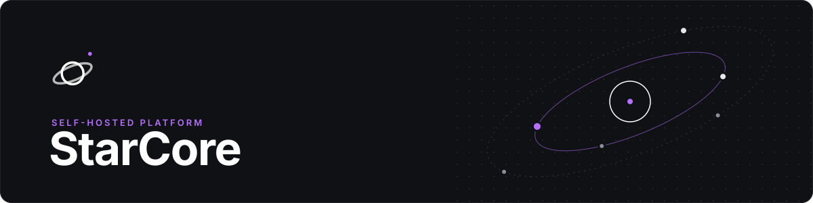
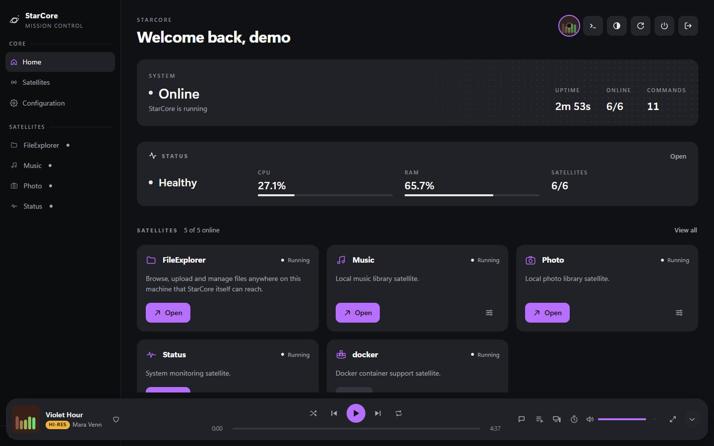
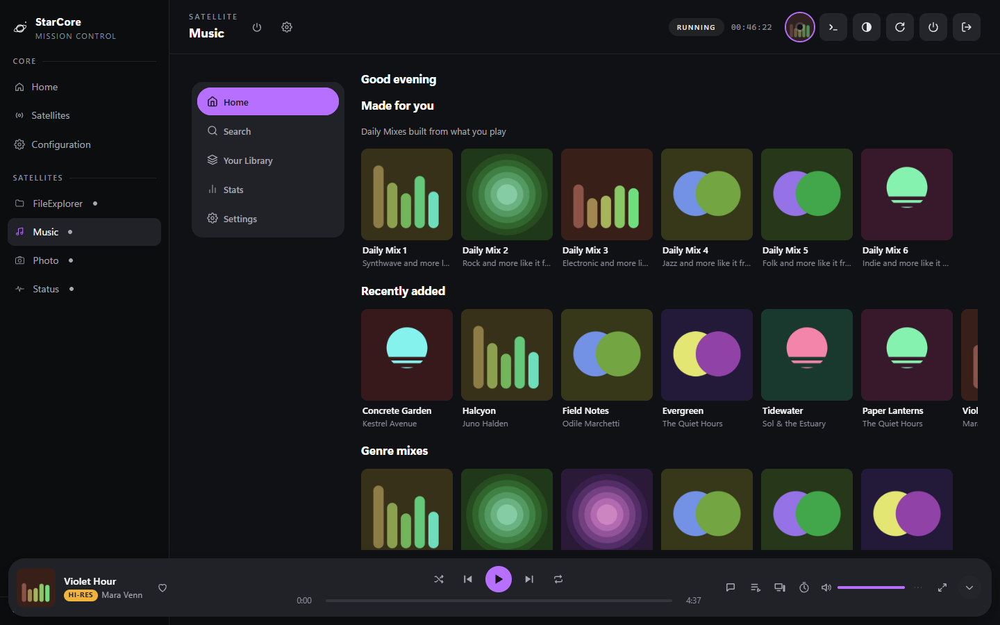
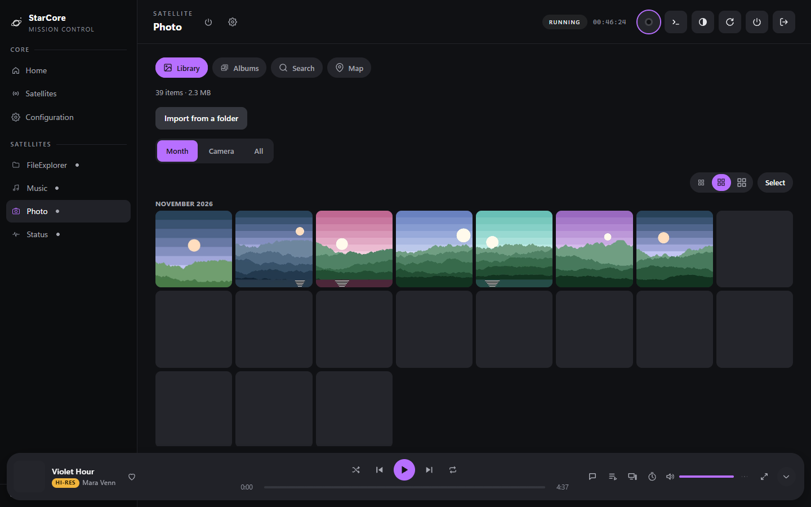
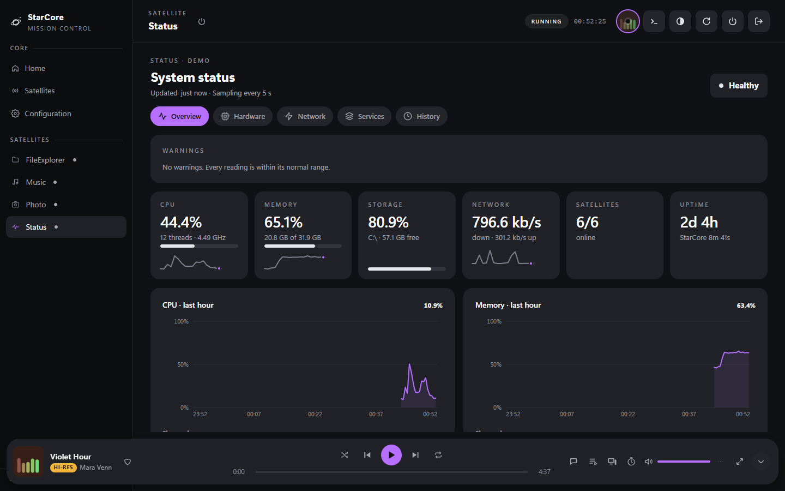
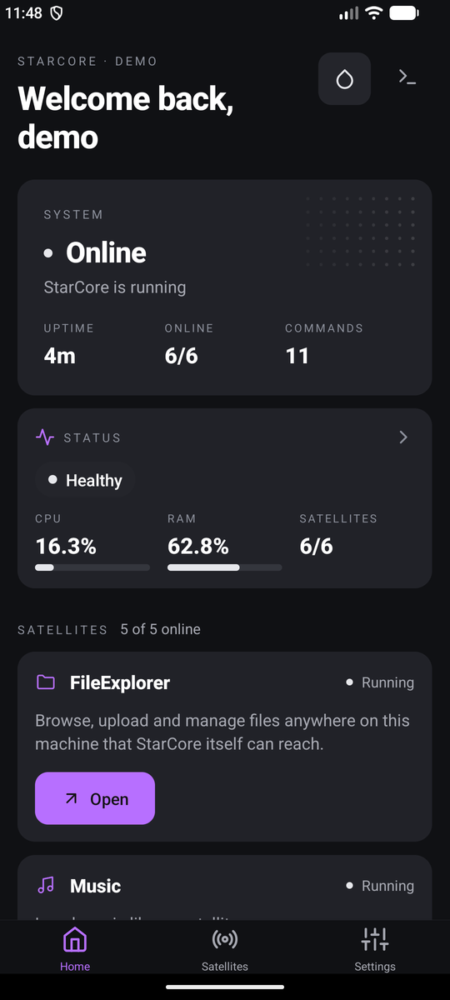
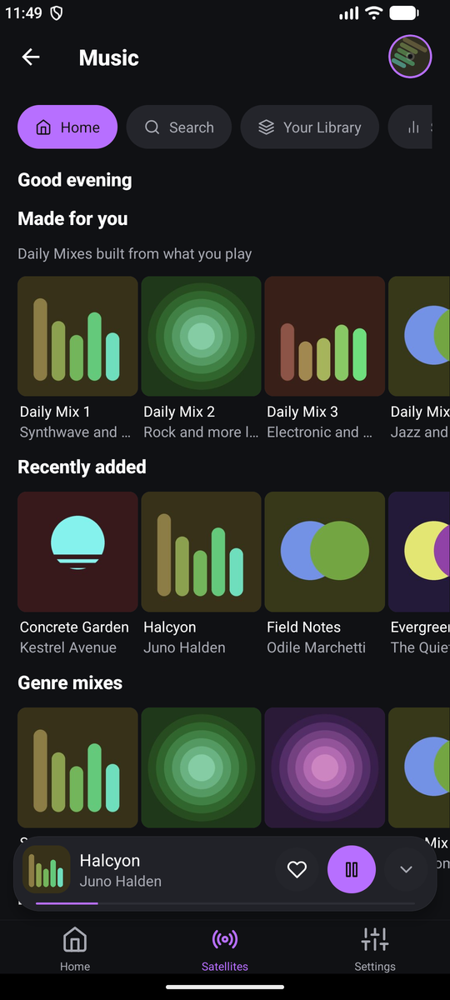
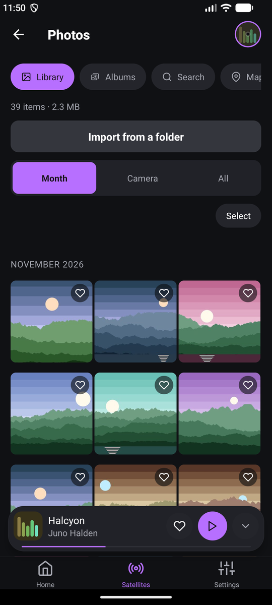
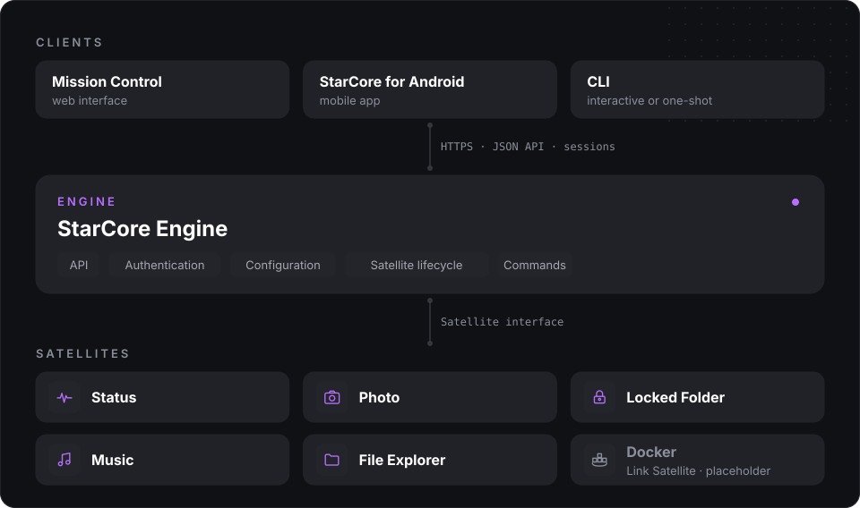

<p align="center">
  
</p>

<p align="center">
  A modular, self-hosted platform: one Engine, one API, one sign-in and one interface<br>
  for the services you run at home.
</p>

<p align="center">
  <a href="https://github.com/mello-ww/starcore/releases/tag/v0.1.0"></a>
  <a href="https://github.com/mello-ww/starcore/actions/workflows/ci.yml"></a>
  
  
  <a href="LICENSE"></a>
</p>

<p align="center">
  <a href="#get-started">Get started</a>
  &nbsp;·&nbsp; <a href="#satellites">Satellites</a>
  &nbsp;·&nbsp; <a href="#build-your-own-satellite">Build a Satellite</a>
  &nbsp;·&nbsp; <a href="docs/README.md">Documentation</a>
  &nbsp;·&nbsp; <a href="docs/project/roadmap.md">Roadmap</a>
</p>

---

Self-hosting usually means a pile of separate applications, each with its own interface, its
own API and its own accounts. StarCore puts them on a common foundation:

- **one Engine** that loads, configures and supervises every feature
- **one API** that the web interface, the Android app and the CLI all speak
- **one sign-in** protecting every endpoint
- **one interface**, on the web and on Android, in the same visual language

Every feature is a **Satellite** you can enable or disable. A Satellite describes its
interface once; both clients draw it natively, with no client code of its own.

<p align="center">
  
</p>

## A look around

**Mission Control** is the web interface the Engine serves itself.

<table>
  <tr>
    <td width="50%"></td>
    <td width="50%"></td>
  </tr>
  <tr>
    <td align="center"><sub>Music</sub></td>
    <td align="center"><sub>Photos</sub></td>
  </tr>
</table>

<p align="center">
  
  <br><sub>Status</sub>
</p>

**StarCore for Android** talks to the same API and draws the same interfaces with native
components.

<p align="center">
  
  &nbsp;
  
  &nbsp;
  
  <br><sub>Home · Music · Photos</sub>
</p>

<sub>Screenshots of the real interfaces (v0.1.0) running against a throwaway demo server. The
music and photos are generated demo content; system readings are real.</sub>

## Satellites

| Satellite | What it does | On |
| --- | --- | --- |
|  [**Status**](docs/satellites/status.md) | System readings, history and warnings | Web · Android |
|  [**Photo**](docs/satellites/photo.md) | Photo and video library with albums, map and phone backup | Web · Android |
|  [**Locked&nbsp;Folder**](docs/satellites/locked_folder.md) | PIN-protected private area in Photos, optionally encrypted | Web · Android |
|  [**Music**](docs/satellites/music.md) | Music library, streaming, playlists, Daily Mixes, lyrics, Connect | Web · Android |
|  [**File&nbsp;Explorer**](docs/satellites/file_explorer.md) | Browse, preview, upload and manage files | Web · Android |
|  **Docker** | *Link Satellite* - a placeholder that loads and reports its status | — |

<sub>The Locked Folder lives inside Photos. See [How Satellites work](docs/satellites/README.md).</sub>

## Architecture

<p align="center">
  
</p>

- **Engine** — the core runtime. It exposes the API, authenticates every request, owns the
  configuration and manages each Satellite's lifecycle and commands.
- **Native Satellites** — features that run inside StarCore.
- **Link Satellites** — integrations with external services. Docker is the first, still a
  placeholder.
- **Mission Control**, **StarCore for Android** and the **CLI** — three clients of the same
  API. None of them contains code for a particular Satellite.

More in [Architecture](docs/concepts/architecture.md), [Terminology](docs/concepts/terminology.md)
and [Philosophy](docs/concepts/philosophy.md).

## Get started

### Run it locally

Requires Python 3.13 and [uv](https://docs.astral.sh/uv/), on Windows or Linux.

```
cd engine
uv sync --extra thumbnails --extra encryption
uv run python -m starcore
```

Open http://127.0.0.1:8080 on the same machine and create the administrator account. The two
extras add photo thumbnails (Pillow) and Locked Folder encryption (cryptography); FFmpeg on
`PATH` adds video thumbnails and Music transcoding. Run in a terminal, the interactive
[CLI](docs/guide/cli.md) starts alongside.

### Run it on a Linux server

[`deploy/linux/install.sh`](deploy/linux/install.sh) installs StarCore as a hardened systemd
service under its own user. It never starts anything or touches nginx on its own.

```
sudo bash deploy/linux/install.sh            # first install
sudo systemctl enable --now starcore
sudo bash deploy/linux/install.sh --update   # later: fast-forward and re-sync
```

[Deployment](docs/guide/deployment.md) has the full walkthrough: HTTPS behind nginx, LAN
access, configuration and Windows unattended startup. StarCore also runs in [Docker](docs/guide/docker.md).

### Install the Android app

Download `StarCore-0.1.0.apk` from the
[release page](https://github.com/mello-ww/starcore/releases/tag/v0.1.0) and enter your
server's address on first launch. Android 7.0 or later. To build it yourself, see
[`mobile/README.md`](mobile/README.md).

## Build your own Satellite

A Satellite is a folder: a manifest, routes that return JSON, and a `ui.json` that binds
blocks to those routes. Mission Control and the Android app both draw it.

```json
{
  "contract": "starcore.ui/1.0",
  "entry": "home",
  "pages": {
    "home": {
      "source": {"route": "summary", "refresh": 10},
      "blocks": [
        {"type": "field", "label": "Received", "value": "$.greetings", "format": "integer"},
        {"type": "button", "label": "Say hello", "style": "primary",
         "action": {"route": "greet", "then": "refresh"}}
      ]
    }
  }
}
```

[Your first Satellite](docs/guide/first-satellite.md) builds this one in three small files;
the [UI contract](docs/reference/ui-contract.md) lists every block, action and format.

## Documentation

The [documentation index](docs/README.md) has everything. The usual starting points:

| To… | Read |
| --- | --- |
| Install and configure StarCore | [Deployment](docs/guide/deployment.md) · [Docker](docs/guide/docker.md) |
| Use it | [Mission Control](docs/guide/mission-control.md) · [CLI](docs/guide/cli.md) · [Android app](mobile/README.md) |
| Understand it | [Architecture](docs/concepts/architecture.md) · [Terminology](docs/concepts/terminology.md) · [Philosophy](docs/concepts/philosophy.md) |
| Build on it | [Your first Satellite](docs/guide/first-satellite.md) · [How Satellites work](docs/satellites/README.md) · [UI contract](docs/reference/ui-contract.md) · [API](docs/reference/api.md) |
| Follow the project | [Roadmap](docs/project/roadmap.md) · [Changelog](CHANGELOG.md) · [Releasing](docs/project/releasing.md) |

## Security

A single administrator account protects every API endpoint: Mission Control, Satellite
management, shutdown and restart, and every Satellite's own routes. A fresh install answers
only the machine it runs on, and remote setup needs a one-time code. Sign-in attempts are
throttled per client, also behind a reverse proxy. Mission Control serves HTTPS itself with a
certificate you provide, or sits behind nginx.

Details are in "Authentication" in the [API](docs/reference/api.md) and in
[Deployment](docs/guide/deployment.md); the latest security review is in the
[Roadmap](docs/project/roadmap.md). To report a vulnerability, see [SECURITY.md](SECURITY.md).

## Project status

**v0.1.0** is the first stable release: every Satellite is on its shared interface (UI
contract 1.2) on the web and on Android.

- [Release notes and known limitations](docs/releases/v0.1.0.md)
- [Changelog](CHANGELOG.md)
- [Roadmap](docs/project/roadmap.md): the current state and what comes next

Mission Control (Configuration > About) and the Android app (Settings > About) show the exact
version, build and commit, and can copy them for a bug report.

## How StarCore is built

StarCore started as something I wanted for my own homelab, not as a product. AI tools are
capable, affordable and open to anyone right now, and there is no telling how long that will
last, so writing every line by hand made little sense for a project like that. I built most
of it with [Claude](https://claude.com/claude-code).

Most of the Engine's backend and a few other parts were written by hand; the rest was written
by Claude under my direction. Every change is supervised, reviewed and tested by me before it
lands.

## Contributing

Issues and pull requests are welcome. [CONTRIBUTING.md](CONTRIBUTING.md) covers the setup,
the checks to run and the few architectural rules a change must follow.

## License

StarCore is free software, released under the
[GNU General Public License v3.0](LICENSE) (GPL-3.0).

<p align="center"><sub>The README's graphics are generated from Mission Control's own tokens
and icons by <a href="docs/assets/readme/generate.py"><code>docs/assets/readme/generate.py</code></a>.</sub></p>
