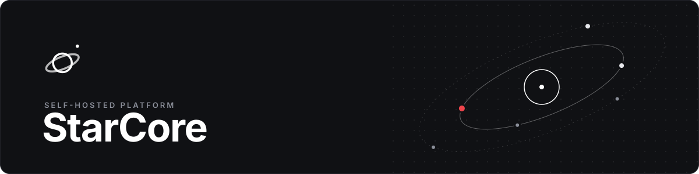
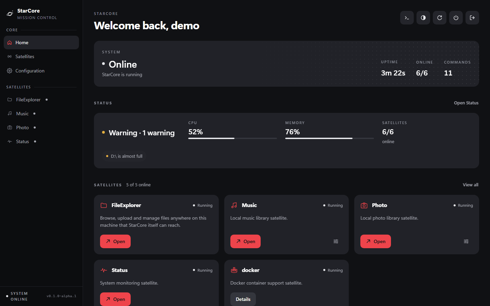
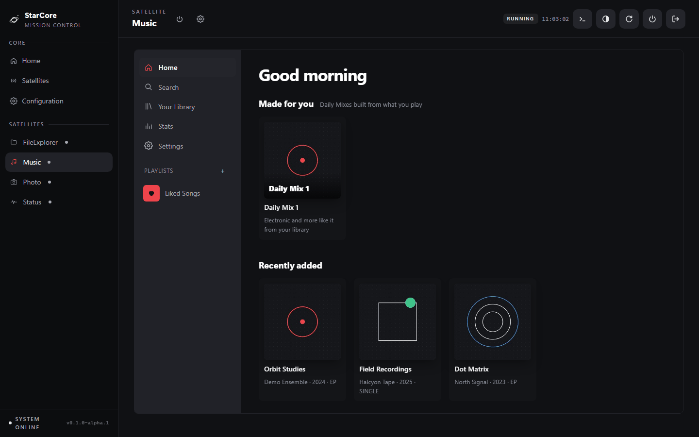
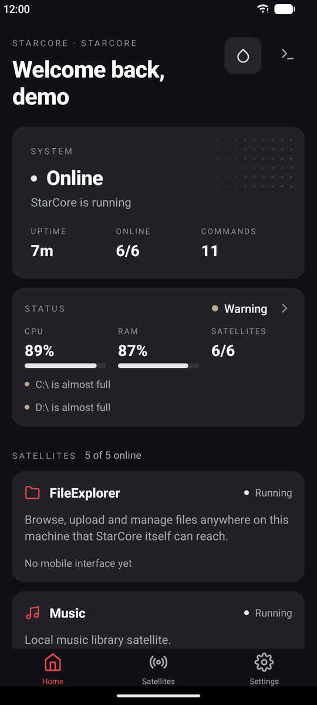
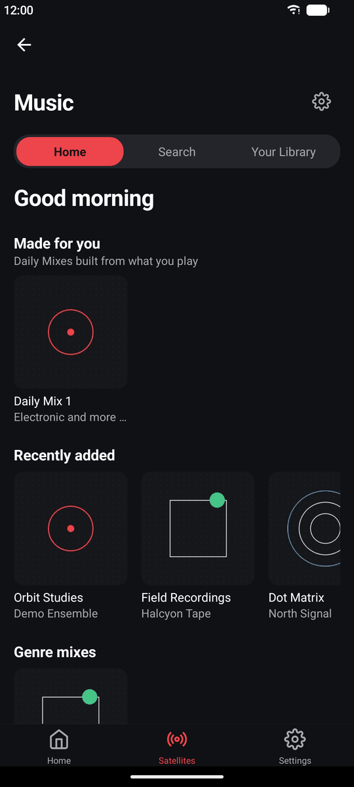
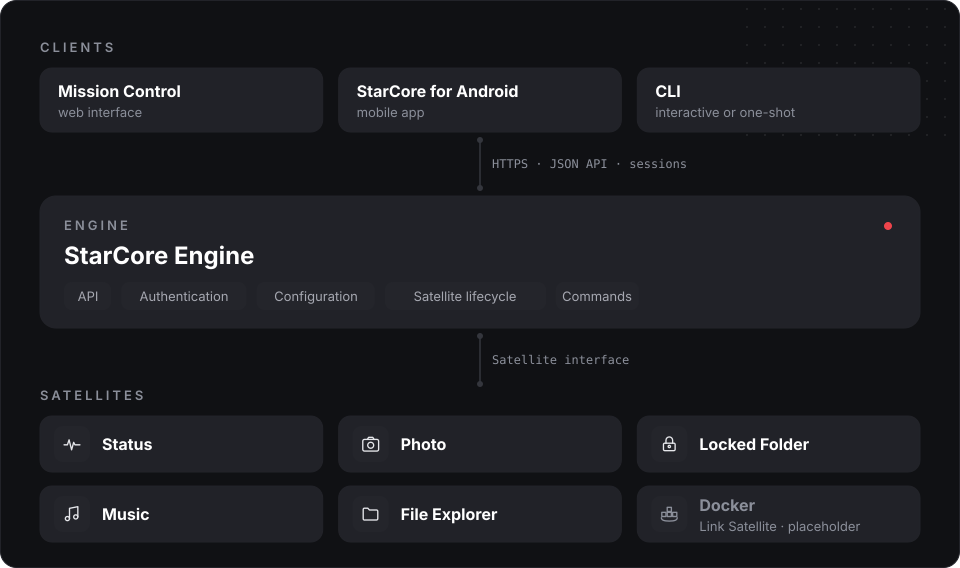

<p align="center">
  
</p>

<p align="center">
  A modular, self-hosted platform: one Engine, one API, one sign-in and one interface<br>
  for the services you run at home.
</p>

<p align="center">
  <a href="https://github.com/mello-ww/starcore/releases/tag/v0.1.0-alpha.1"><b>v0.1.0-alpha.1</b> · pre-release</a>
  &nbsp;·&nbsp; <a href="#get-started">Get started</a>
  &nbsp;·&nbsp; <a href="#satellites">Satellites</a>
  &nbsp;·&nbsp; <a href="#documentation">Documentation</a>
</p>

---

StarCore provides a single Engine capable of powering both native features and integrations
with existing self-hosted applications. Instead of managing isolated applications with
different interfaces, APIs and authentication systems, StarCore provides a common foundation
where services coexist and work together:

- **one Engine** that loads, configures and supervises every feature
- **one API** that Mission Control, the Android app and the CLI all speak
- **one sign-in** protecting every endpoint once the administrator account exists
- **one interface**, on the web and on Android, in the same visual language

Install only what you need: every feature is a Satellite you can enable or disable.

<p align="center">
  
</p>

## Interfaces

**Mission Control** is the web interface the Engine serves itself. **StarCore for Android**
talks to the same API and shares its design tokens (`mission_control/tokens.css`,
mirrored in `mobile/src/theme/tokens.ts`).

<p align="center">
  
  <br><sub>Music in Mission Control</sub>
</p>

<p align="center">
  
  &nbsp;&nbsp;
  
  <br><sub>StarCore for Android · Home and Music</sub>
</p>

<sub>Screenshots of the real interfaces (v0.1.0-alpha.1) running against a throwaway demo server.
The music library is generated demo content; system readings are real.</sub>

## Architecture

<p align="center">
  
</p>

- **Engine** — the core runtime. It exposes the API, authenticates every request, owns the
  configuration and manages each Satellite's lifecycle and commands.
- **Native Satellites** — features that run inside StarCore: Status, Photo, Locked Folder,
  Music and File Explorer.
- **Link Satellites** — integrations with external services. Docker is the first, still a
  placeholder.
- **Mission Control** — the official web interface, served by the Engine.
- **StarCore for Android** — the mobile app, in [`mobile/`](mobile/README.md).
- **CLI** — interactive alongside a running StarCore, or one-shot from scripts.
- **Signals** — the internal event system (planned, not implemented yet).

More in [Architecture](docs/architecture.md) and [Terminology](docs/terminology.md).

## Satellites

| Satellite | What it does | On |
| --- | --- | --- |
|  [**Status**](docs/satellites/status.md) | System readings, history and warnings | Web · Android |
|  [**Photo**](docs/satellites/photo.md) | Photo and video library with albums, map and phone backup | Web · Android |
|  [**Locked&nbsp;Folder**](docs/satellites/locked_folder.md) | PIN-protected private area in Photos, optionally encrypted | Web · Android |
|  [**Music**](docs/satellites/music.md) | Music library, streaming, playlists, Daily Mixes, lyrics, Connect | Web · Android |
|  **File&nbsp;Explorer** | Browse, upload and manage files | Web |
|  **Docker** | *Link Satellite* - a placeholder that loads and reports its status | — |

<sub>Locked Folder on Android lives in the Photos tab; its location, encryption and recovery are
managed from Mission Control. See [Satellites](docs/satellites.md) for how Satellites work and
how to build one.</sub>

## Get started

### Run it locally

Requires Python 3.13, on Windows or Linux. [uv](https://docs.astral.sh/uv/) installs the
optional extras: Pillow for thumbnails and cryptography for Locked Folder encryption.
FFmpeg, if it's on `PATH`, adds video thumbnails and Music transcoding.

```
cd engine
uv sync --extra thumbnails --extra encryption
uv run python -m starcore
```

This starts the Engine, loads the Satellites and serves Mission Control at
http://127.0.0.1:8080. Open it on the same machine to create the administrator account.
From any other device, the setup screen also asks for the one-time setup code StarCore prints
at startup.

Run in a terminal, the interactive CLI starts alongside it; run headless (a service manager,
no terminal attached), StarCore runs Mission Control on its own instead. The interactive CLI
can also be started directly with `python -m starcore.cli.main`.

To run a single command and exit - from a script, or while StarCore runs elsewhere - pass it
as arguments:

```
python -m starcore help
python -m starcore engine health --json
```

See the [CLI documentation](docs/cli.md) for every command, `--json`, exit codes and permissions.

### Run it on a Linux server

[`deploy/linux/install.sh`](deploy/linux/install.sh) installs StarCore as a hardened systemd
service under its own user, with data in `/var/lib/starcore`, and never starts anything or
touches nginx on its own. [`deploy/nginx/starcore-panel.conf`](deploy/nginx/starcore-panel.conf)
is the HTTPS reverse proxy in front of it.

```
sudo bash deploy/linux/install.sh            # first install
sudo systemctl enable --now starcore
sudo bash deploy/linux/install.sh --update   # later: fast-forward and re-sync
```

See [Deployment](docs/deployment.md) for the full walkthrough, HTTPS, LAN access and Windows
unattended startup, and [Releasing](docs/releasing.md) for updates, backups and rollback.

### Install the Android app

Download `StarCore-0.1.0-alpha.1.apk` from the
[release page](https://github.com/mello-ww/starcore/releases/tag/v0.1.0-alpha.1) and enter
your server's address on first launch. A public host name is tried over HTTPS, a LAN address
such as `192.168.1.20:8090` over HTTP. Android 7.0 or later. To build it yourself, see
[`mobile/README.md`](mobile/README.md).

## Security

StarCore's single-administrator authentication protects every API endpoint (Mission Control,
Satellite management, shutdown and restart, and every Satellite API) once the administrator
account exists. Before that, a fresh install answers only the machine it runs on, and remote
setup needs a one-time code. Sign-in attempts are throttled per client, also behind a reverse
proxy. Mission Control can serve HTTPS itself with a certificate you provide, or sit behind
nginx. See "Authentication" and "HTTPS" in [API](docs/api.md) and [Deployment](docs/deployment.md),
and the latest security review in the [Roadmap](docs/roadmap.md).

## Release

The current release is **v0.1.0-alpha.1**, the first Alpha: a stable checkpoint to test and
build on, not a feature-complete 1.0.

- [Release notes and known limitations](docs/releases/v0.1.0-alpha.1.md)
- [Changelog](CHANGELOG.md)
- [How releases are versioned, signed and published](docs/releasing.md)

Mission Control (Configuration > About) and the Android app (Settings > About) show the exact
version, build and commit, and can copy them for a bug report.

## Documentation

- [API](docs/api.md)
- [Architecture](docs/architecture.md)
- [CLI](docs/cli.md)
- [Deployment](docs/deployment.md)
- [Mission Control](docs/mission_control.md)
- [Philosophy](docs/philosophy.md)
- [Releasing](docs/releasing.md)
- [Roadmap](docs/roadmap.md) (also the current state, known limitations and latest security review)
- [Satellites](docs/satellites.md)
- [Terminology](docs/terminology.md)
- [UI contract](docs/ui-contract.md) (how Satellites describe their interfaces for every client)
- [Audio playback](docs/media-audio.md) (the shared `media.audio` host and `audio.library` capability)
- [StarCore for Android](mobile/README.md)

## License

StarCore is free software, released under the
[GNU General Public License v3.0](LICENSE) (GPL-3.0).

<p align="center"><sub>The README's graphics are generated from Mission Control's own tokens
and icons by <a href="docs/assets/readme/generate.py"><code>docs/assets/readme/generate.py</code></a>.</sub></p>
