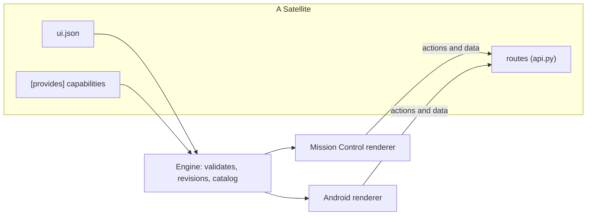
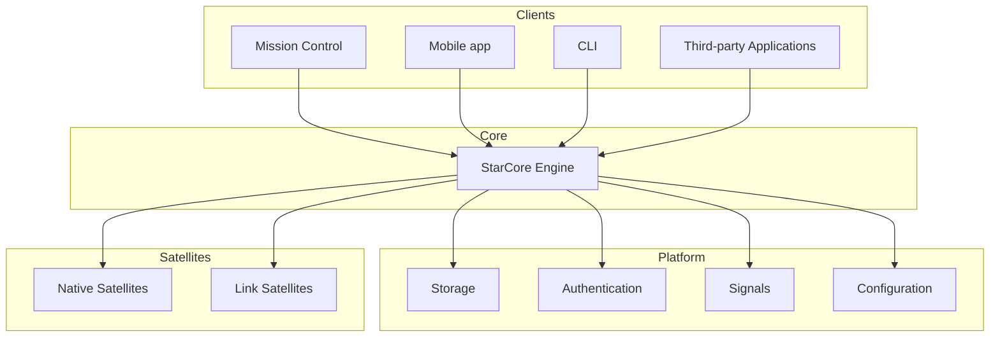

## Components

### Engine

The Engine is the foundation of StarCore.

It coordinates the platform, exposes the public API, manages the lifecycle of Satellites and provides shared platform services such as storage, authentication, configuration and the internal event system.

### Satellites

Satellites extend StarCore without modifying the Engine itself.

Each Satellite is an independent module that can expose API endpoints, store data, emit Signals, describe its interface and provide capabilities to other Satellites.

There are two categories of Satellites:

- **Native Satellites**, which provide functionality directly within StarCore (Status, Files, Photos, Music...).
- **Link Satellites**, which integrate third-party applications and services (Docker, Jellyfin, Home Assistant...).

### Mission Control

Mission Control is the official graphical interface for StarCore.

It communicates exclusively with the Engine through its public API.

The Engine starts it as part of its own lifecycle and serves both the API and the interface over HTTP.

### Mobile

`mobile/` is StarCore's native mobile client (Android first, with an architecture that adds iOS
later) - a separate application that speaks to the Engine's existing public API exactly like
Mission Control does, over the same `/api/...` endpoints and the same session system, rather than
a second backend of its own. See `mobile/README.md`.

Audio playback is moving to one host per client (`media.audio`), which plays content any
Satellite provides through `audio.library`. See [docs/media-audio.md](media-audio.md).

## Design

The Engine remains generic while functionality is added through Satellites.

By using a common Satellite system for both native features and third-party integrations, StarCore keeps a consistent extension model and avoids maintaining multiple plugin systems.

## Interfaces

Clients know UI contracts and capabilities, not individual Satellites.

- A Satellite **describes** its interface in a `ui.json` (the [UI contract](ui-contract.md)): pages, navigation and blocks, bound to the live data its own routes return.
- The Engine **validates** each description when it loads the Satellite, gives it a revision, and keeps the **catalog**: what every Satellite is, and the **Satellite capabilities** each provides to the others (`files.browse`, for a start).
- Mission Control and the Android app **render** the same description, each with its own platform components and the shared design tokens. Neither runs code it receives.
- **Shared blocks** are bound to a capability, not to a Satellite, so any Satellite can embed them: the file browser works through whichever Satellite provides `files.browse`.
- What a client can do natively - audio playback, biometrics, background work - is a **client capability**. A Satellite that needs a new one needs a client update once; every Satellite after it reuses it.

**Today**, this runs alongside what came before it. Status is the first existing Satellite drawn entirely from its `ui.json` (UI contract 1.1), on both clients and on Home. Photo, Music and the Locked Folder keep their dedicated, hand-written screens on both clients (and their Mission Control `page.js`) until the shared blocks reach parity with them. Those screens are the reference the shared components are extracted from, not code to discard. A handful of name-based couplings from before the contract remain, each listed in a test that only lets the list shrink. See "Current implementation and target" and "Migration" in [UI contract](ui-contract.md).

## Component overview

