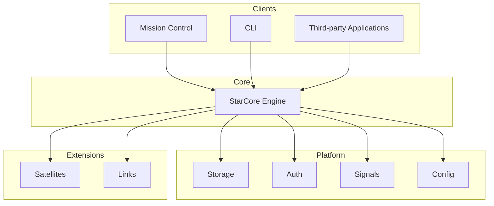

# Architecture

StarCore is built around a modular architecture where each component has a clearly defined responsibility.

The platform is composed of a single Engine surrounded by independent modules called Satellites and Links.

The Engine acts as the foundation of the platform. It is responsible for coordinating components, exposing the API, managing the lifecycle of modules and providing shared platform capabilities such as storage, authentication, configuration and the internal event system.

Satellites are responsible for implementing features. They extend the platform without modifying the Engine itself. A Satellite may expose API endpoints, store data, register pages in Mission Control and communicate through Signals.

Links provide integrations with external software and services. Instead of replacing existing applications, StarCore can connect to them and present a unified experience through Mission Control.

Mission Control is the official graphical interface. It communicates exclusively with the Engine through its public API.

This separation allows the Engine to remain generic while new functionality is continuously added through Satellites and Links.

## Component overview

