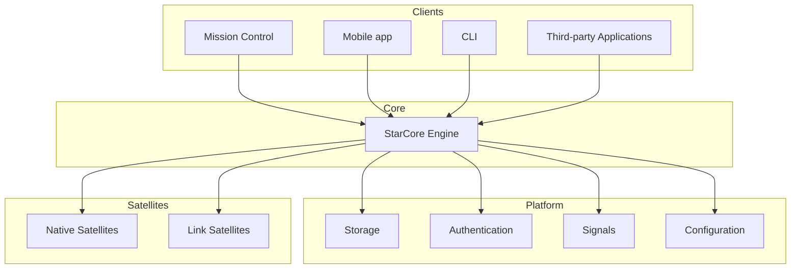

## Components

### Engine

The Engine is the foundation of StarCore.

It coordinates the platform, exposes the public API, manages the lifecycle of Satellites and provides shared platform services such as storage, authentication, configuration and the internal event system.

### Satellites

Satellites extend StarCore without modifying the Engine itself.

Each Satellite is an independent module that can expose API endpoints, store data, emit Signals and contribute pages to Mission Control.

There are two categories of Satellites:

- **Native Satellites**, which provide functionality directly within StarCore (Status, Files, Photos, Music...).
- **Link Satellites**, which integrate third-party applications and services (Docker, Jellyfin, Home Assistant...).

### Mission Control

Mission Control is the official graphical interface for StarCore.

It communicates exclusively with the Engine through its public API.

The Engine starts it as part of its own lifecycle and serves both the API and the interface over HTTP.

### Mobile

`mobile/` is StarCore's native mobile client (Android first, with an architecture that adds iOS
later) - a separate application that speaks to the Engine's existing public API exactly like
Mission Control does, over the same `/api/...` endpoints and the same session system, rather than
a second backend of its own. See `mobile/README.md`.

## Design

The Engine remains generic while functionality is added through Satellites.

By using a common Satellite system for both native features and third-party integrations, StarCore keeps a consistent extension model and avoids maintaining multiple plugin systems.

## Component overview

